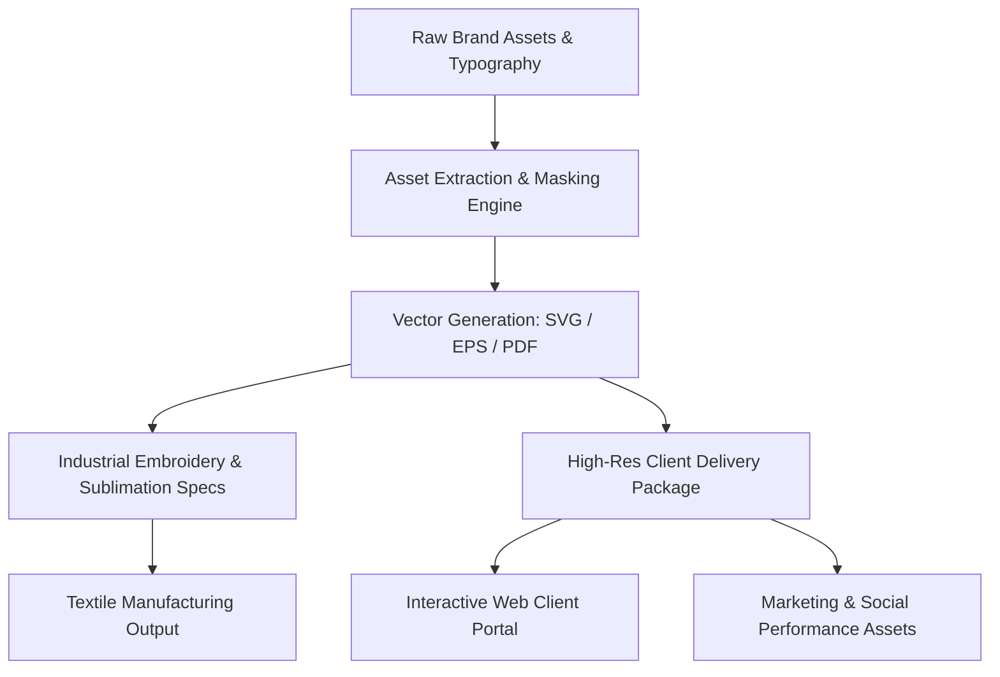

# SF Operations Suite: Brand Asset Automation & Production Engine

> **Automated vectorization, digital asset management, sublimation pipelines, and web storefront generation for entertainment and corporate branding operations.**

---

## 🎯 Project Overview

The **SF Operations Suite** is an end-to-end multimedia operations and digital packaging platform. Built to automate commercial entertainment branding, corporate uniforms, and digital production assets, the suite streamlines:

- **Automated Vector & Raster Asset Pipelines:** High-resolution vectorization, alpha masking, and embroidery format compilation.
- **Textile & Sublimation Production Packages:** Standardized CMYK color management, high-precision typography layout engines, and technical specifications for industrial embroidery machines.
- **Interactive Web Portals:** Dynamic client delivery showcases (`/web_lista_para_subir`) featuring real-time download packaging, interactive asset previews, and mobile-first design.
- **Social Media & Performance Assets:** Automated Instagram layouts, marketing collateral generation, and promotional packaging.

---

## 🏛️ Pipeline Topology

---

## 🚀 Key Modules & Capabilities

### 1. Vector & Embroidery Compiler (`build_clean_embroidery_vectors.py`, `build_sublimation_package.py`)
- Automated generation of pixel-perfect vector files for industrial textile reproduction.
- Programmatic color separation, contrast balancing, and edge smoothing for embroidery needle paths.

### 2. Client Delivery & Asset Distribution Portal (`/web_lista_para_subir`)
- Zero-dependency client interface providing instant previewing of corporate identity items, embroidery uniforms, and high-resolution logo suites.
- Embeds base64-optimized asset caches for instantaneous rendering without external CDN dependencies.

### 3. Visual & Mockup Automation (`ig_profile_mockup.html`, `build_embroidery_visuals.py`)
- Automated generation of social mockups, Instagram grid compositions, and promotional marketing collateral.

---

## 📄 License & Attribution

Architected and maintained by **Daniel Minguez**  
Operations, Settlement & Regulatory Compliance Specialist  
Madrid, Spain (EU) / Worldwide Remote  
GitHub: [@danielalejming-ops](https://github.com/danielalejming-ops) | LinkedIn: [Daniel Minguez](https://linkedin.com/in/daniel-minguez)
